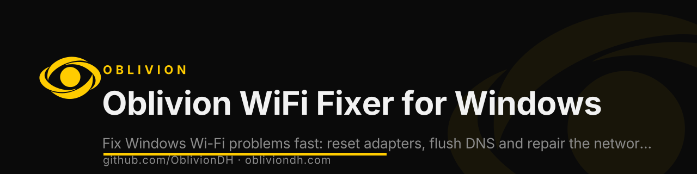

  

<h1 align="center">Oblivion WiFi Fixer for Windows</h1>

  
  
  
  

<b>Fix Windows Wi-Fi problems fast: reset adapters, flush DNS and repair the network stack in one click. By Oblivion.</b>

`windows` · `wifi` · `wifi-fix` · `troubleshooting` · `network-repair` · `dns-flush`

---

**🚨 ABSURDLY-CRITICAL WARNING: READ THIS OR PERISH 🚨**  
I am NOT, under ANY circumstance, liable if this script nukes your registry, bricks your Wi-Fi, formats C:\, burns your toast, or somehow manages to install Edge 15 times. BACK. UP. EVERYTHING. TWICE. Then sacrifice an old router to the IT gods. You've been warned.

---

## 😡 What Fresh Hell Is This?

It’s a batch script. Yes. **A batch script.** In 2025.  
It’s the digital equivalent of kicking Windows in the shins and hoping it behaves.  
This script abuses CMD like Microsoft abuses user trust. Will it help? Maybe. Will it break stuff? Probably. Will it make you feel better? Absolutely.

**Think of it as a last-ditch attempt to make Wi-Fi suck slightly less on Windows. Emphasis on “slightly.”**

---

## 🔥 Why Does This Exist?

Because Microsoft’s Wi-Fi stack was clearly written during a hangover.  
Every update “fixes” something and breaks three other things.  
We got tired of dealing with their half-baked network manager, so we built this rage-fueled Frankenstein script instead.

---

## 🧙 How This Glorious Disaster Works

This arcane spellbook of system tweaks does the following:

- Disables Wi-Fi power saving because Windows thinks you want to save 0.0001% battery at the cost of 90% performance ⚰️  
- Forces DNS changes because your ISP’s DNS was last updated in 2007  
- Fiddles with TCP/IP settings you probably didn’t even know existed ⚙️  
- Slaps Windows in the face with a profile reset  
- Basically, it's a sacrificial ritual disguised as tech support

All pulled from forums, Reddit rants, and whispered dark magic from sysadmins on the brink of madness.

---

## 🧨 Instructions (aka the ritual steps)

1. Download `Wi-Fi_Optimization.bat`  
2. **Run as Administrator** (because Microsoft won't let you breathe without it)  
3. Watch the CMD spam like it’s doing something important  
4. Reboot and pray to Tux the Penguin 🐧  
5. If it works: awesome. If not: blame Microsoft, not me.

---

## ⚠️ LEGAL THREATS & DISCLAIMERS

- **NO SUPPORT. NO HAND-HOLDING. NO MERCY.**  
- You break it, you fix it. Learn Google-Fu.  
- This is released under the **GPL-3.0 license**, which basically means “do what you want, but don’t sue me.”  
- If Microsoft’s lawyers are reading this, I’d like to say: *your OS is trash*. ❤️

---

## 🧯 FAQ (Frequently Abused Questions)

**Q: Does this actually work?**  
A: Occasionally. Like Windows Update.

**Q: Will this make my cat stop hating me?**  
A: No. But it might make you hate Microsoft even more.

**Q: What happens if I run this on my work laptop?**  
A: You’ll either become the office hero or get fired. 50/50.

---

## 🧠 Contributing

Feel free to fork, edit, or scream into the void. PRs welcome, especially if they make Windows cry harder.  
Linux tweaks get bonus points. Windows patches get mocked unless they involve disabling telemetry.

---

## 👻 Final Thoughts

You’re not alone. We’ve all screamed at a network adapter not working for no reason.  
This script is your way of screaming *back*.  
Let’s face it — **Windows is a virus with a GUI.** This script is the antivirus.

---

## 📞 Support

**Discord:** https://discord.gg/na8gqhQYJR  
Come for the memes, stay for the collective pain of debugging Windows.

---

**Oblivion**  
🔥 Fixing Microsoft’s screw-ups so you don’t have to – with fire, rage, and duct tape.  
**Linux-first. Windows? Only when absolutely forced at gunpoint.**

---

*Developed through suffering by [@ivanbg_2004](https://github.com/ivanbg2004) and remastered by Oblivion after 6 long years of trauma.*

P.S. Let me know if you want to **auto-replace Edge's system sound with a Wilhelm scream** or set the default browser to `/dev/null`.

## About Oblivion

Built by [**Oblivion**](https://obliviondh.com) — cybersecurity, cloud and AI. This tool is part of the Oblivion open-source toolkit.

- 🌐 Website: [obliviondh.com](https://obliviondh.com)
- 🎓 Learn: [Oblivion Academy](https://academy.obliviondh.com)
- 💬 Community: [Discord](https://discord.gg/f4mZBU9xS8)
- 🔗 All links: [linktr.ee/ivanbg2004](https://linktr.ee/ivanbg2004)
- 👤 Author: [Ivan Barnola Gasch](https://www.linkedin.com/in/ivanbg2004/)

Keywords: windows, wifi, wifi-fix, troubleshooting, network-repair, dns-flush, batch-script, sysadmin.

© 2026 Oblivion. If this project helped you, leave a ⭐ — it helps others find it.

